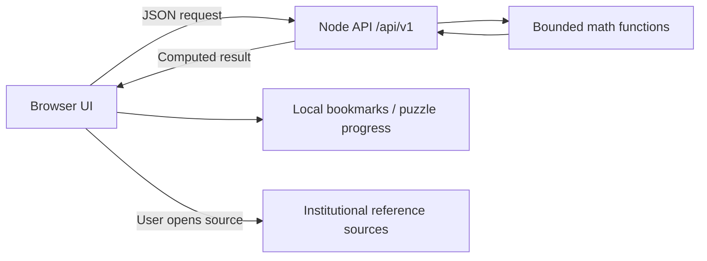

# MathLens

**Understand the mathematics. Explain the intelligence. Discover what comes next.**

A dependency-free mathematics and model-analysis workbench, styled with a near-black canvas, Geist typography, opaque graphite panels, and static mathematical illustrations.

**Version: 0.2.0-alpha.1.** This is a working web alpha, not the completed production platform in the master brief. Native packages are not available. Vercel deployment and optional Supabase email authentication are supported; see AUTHENTICATION.md for required owner configuration.

## Live application

[Open MathLens](https://mathlens-wine.vercel.app) · [Sign in](https://mathlens-wine.vercel.app/#/login)

Deployed to Vercel from this repository. Email authentication pages are included; the owner must configure Supabase before real sign-in is available.

## Run

Requires Node.js 24–26. Tested with Node.js 24.14.1 on Windows. No package installation or API key is required.

```sh
npm start
```

Open [http://127.0.0.1:4173](http://127.0.0.1:4173). For reload during development, use `npm run dev`.

Configure `HOST`, `PORT`, and `NODE_ENV` through your shell, or copy `.env.example` to `.env` and run `node --env-file=.env server/index.mjs`. The default host is loopback. Do not expose the development alpha directly to the internet.

## Current refinement

The second pass adds binary logistic classification, K-means, PCA, regression comparison, a local experiment notebook, matrix operations, numerical roots, definite integrals, statistics, a live arXiv feed, ten puzzle categories and nine lessons. Regression uses Householder QR for improved numerical stability. See [the current refinement audit](REFINEMENT_AUDIT.md) for exact implemented limits and unfinished master-brief requirements. New views still need rendered verification because browser use is disabled.

## Working features

| Module | Actual behavior |
| --- | --- |
| Overview | Responsive workspace with links to every module and a sampled quadratic loss surface |
| AI Model Lab | Real backend QR least-squares regression, binary logistic classification, two-feature K-means/PCA and reproducible comparison; bounded numeric CSV; fixed-seed held-out evaluation; coefficients, predictions, residuals, JSON export |
| Equation Explorer | Safe polynomial calculus; linear/quadratic roots, bisection, definite integration, matrix operations up to 6×6 and statistics; JSON exports |
| Visualizations | Actual gradient descent on θ²; configurable learning rate, initial value and iteration count; complete loss trace |
| Puzzle Arena | Ten categories, three parameter ranges, numeric/fraction answers, hints, solutions, streaks, local progress, daily selection |
| Learning Paths | Nine lessons with worked examples and checked exercises |
| Research | Curated sources plus bounded live arXiv category feeds, source dates/types, search, bookmarks, pagination and graceful fallbacks |
| Open Problems | Six open Millennium problems with official source links and checked date |
| Timeline | Seven editorial entries across cultures, search and field filters, links for further reading |
| Documentation | Limits, API overview, privacy, local export/deletion and honest distribution status |

Optional accounts have sign-in, signup, verification, recovery, refresh and sign-out pages with a server-side Supabase adapter. They need SUPABASE_URL and SUPABASE_PUBLISHABLE_KEY; a missing provider is shown honestly. Account progress sync, a durable research database, generative AI, native binaries, SHAP, trees/forests/boosting and neural networks remain unimplemented. See [the acceptance report](COMPLETION_REPORT.md) for statuses and remaining work.

## Validate & build

```sh
npm test
npm run test:coverage
npm run check
npm run build
node dist/server/index.mjs
```

`dist/` contains a runnable web-server bundle, not a static export or installer. Tests include parser attack strings, polynomial identities, numerical fixtures, train/test isolation, puzzle template validation, API errors and limits. See [TESTING.md](TESTING.md) for actual results and browser checks.

## Structure

```text
public/          Semantic HTML, CSS tokens, browser modules and licensed fonts
shared/          Bounded deterministic mathematical functions
server/          Node HTTP server and versioned JSON endpoints
tests/           Native Node unit, invariant and integration tests
scripts/         Syntax validation, reproducible runtime packaging, benchmarks
.github/         CI, web prerelease workflow and contribution templates
```



## Documentation

[Architecture](ARCHITECTURE.md) · [API](API.md) · [Security](SECURITY.md) · [Privacy](PRIVACY.md) · [Testing](TESTING.md) · [Performance](PERFORMANCE.md) · [Deployment](DEPLOYMENT.md) · [Distribution](DISTRIBUTION.md) · [Research sources](RESEARCH_SOURCES.md) · [Design system](DESIGN_SYSTEM.md) · [Contributing](CONTRIBUTING.md)

## Repository & license

The referenced [upstream repository](https://github.com/manikantbindass/MathInsightAI-Explainable-Math-AI-Model-Analyzer) was empty when first inspected. The GitHub connector initially exposed read-only access; a subsequently verified GitHub CLI connection has write/admin permission and is used for source publication. The original repository name is retained for this deployment update. No native release has been produced.

The owner has not selected a project license. No project LICENSE is imposed; obtain permission before redistribution. Geist and Geist Mono are independently licensed under the SIL Open Font License; their notices are included in `public/fonts/`.
