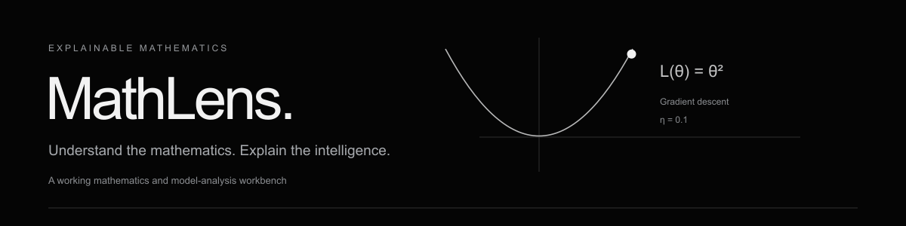
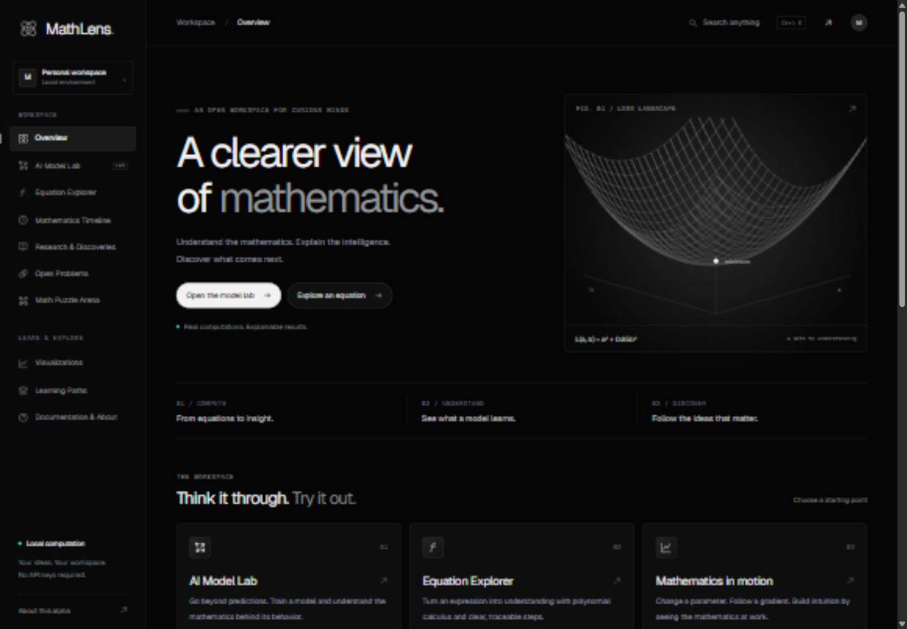
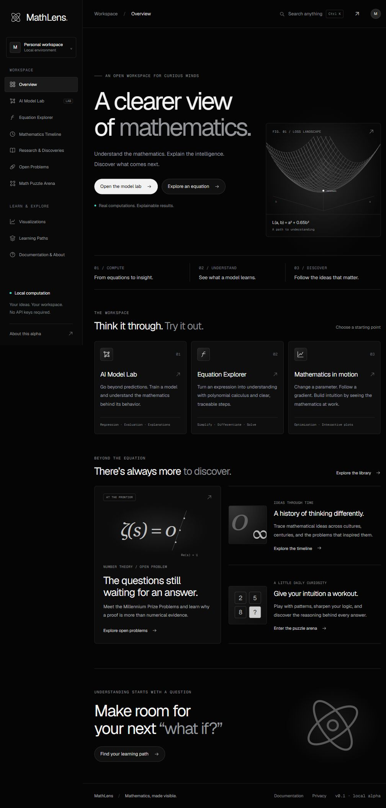
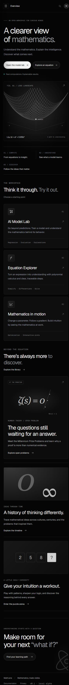
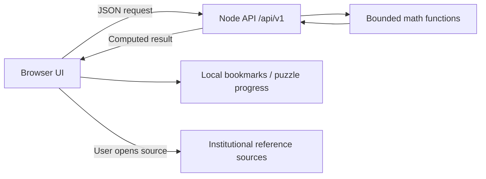

<picture>
  <source media="(prefers-reduced-motion: reduce)" srcset="assets/readme/header-static.svg">
  
</picture>

# MathLens

**Understand the mathematics. Explain the intelligence. Discover what comes next.**

A mathematics and model-analysis workbench with a dependency-free web core, styled with a near-black canvas, Geist typography, opaque graphite panels, and static mathematical illustrations.

**Version: 0.2.0-alpha.1.** The web alpha and experimental native client source are implemented. Tested native downloads are available in the [v0.2.0-alpha.1 prerelease](https://github.com/manikantbindass/mathlens/releases/tag/v0.2.0-alpha.1). Optional Supabase email authentication requires owner configuration; see [authentication setup](AUTHENTICATION.md).

## Live application

[Open MathLens](https://mathlens-wine.vercel.app) · [Sign in](https://mathlens-wine.vercel.app/#/login)

Deployed to Vercel from this repository. Email authentication pages are included; the owner must configure Supabase before real sign-in is available.

## Project screenshots

These actual screenshots document the initial visual alpha, captured on 27 October 2026. They show the overview at three responsive widths; account controls, version labels, and later feature additions differ in the current release. [Try the current live workspace](https://mathlens-wine.vercel.app).

### Desktop workspace

The sidebar groups the model lab, equation tools, research, puzzles, and learning. The overview offers direct starting points and a quadratic loss-surface illustration; this illustration is separate from computed model results.



### Tablet layout

The full overview carries the same navigation and shows the tool entry cards, open-problem introduction, timeline, puzzle invitation, and learning link. This is a narrower rendering of the same page, rather than a separate feature screen.



### Mobile layout

The overview stacks its content into one column and replaces the fixed sidebar with a menu control. The primary actions and footer remain part of the reading order.



## Project explanation

- [PowerPoint presentation](docs/MathLens-Project-Overview.pptx): 20 editable slides explaining the purpose, capabilities, architecture, algorithms, setup, security, and remaining work.
- [PDF overview](docs/MathLens-Project-Overview.pdf): the matching readable presentation.
- [Applications and downloads](https://github.com/manikantbindass/mathlens/releases/tag/v0.2.0-alpha.1): platform build, installation/launch, and APK checks passed.

The experimental Windows, Linux, and Android clients open the hosted workspace and require internet. Windows builds are unsigned; Android test APKs use debug signing. They do not provide offline computation. iOS remains **Coming Soon**. See [distribution details](DISTRIBUTION.md).

## Download applications

| Platform | Package |
| --- | --- |
| Windows x64 | [Unsigned installer](https://github.com/manikantbindass/mathlens/releases/download/v0.2.0-alpha.1/MathLens-0.2.0-alpha.1-windows-x64-unsigned.exe) |
| Linux x86_64 | [AppImage](https://github.com/manikantbindass/mathlens/releases/download/v0.2.0-alpha.1/MathLens-0.2.0-alpha.1-linux-x86_64.AppImage) |
| Android 15+ with current System WebView | [Android 15+ APK — 0.2.0-alpha.2](https://github.com/manikantbindass/mathlens/releases/download/android-v0.2.0-alpha.2/MathLens-0.2.0-alpha.2-android15plus-debug.apk) |

[Release notes and SHA256 checksums](https://github.com/manikantbindass/mathlens/releases/tag/v0.2.0-alpha.1) explain installation, testing, and limitations. All three clients require internet. iOS remains Coming Soon.

### Android 15+ installation

Download the APK directly from the Android row above, or open the [Android 15+ release](https://github.com/manikantbindass/mathlens/releases/tag/android-v0.2.0-alpha.2) and expand **Assets**. Download the `.apk`, not the source-code ZIP, then open it with Android's package installer. This is a debug-signed online testing client and requires internet.

The APK requires Android 15 or newer (minimum SDK 35), with version code 3. Its build and calculation smoke test run on Android 15 and 16 emulators. [Installation notes and limitations](ANDROID_RELEASE_NOTES.md) explain possible certificate conflicts when upgrading the earlier debug alpha. Export important local data before uninstalling an older test app. Production signing and Play Store distribution are not included.

## Run

Requires Node.js 24–26. Tested with Node.js 24.14.1 on Windows. No package installation or API key is required.

```sh
npm start
```

Open [http://127.0.0.1:4173](http://127.0.0.1:4173). For reload during development, use `npm run dev`.

Configure `HOST`, `PORT`, and `NODE_ENV` through your shell, or copy `.env.example` to `.env` and run `node --env-file=.env server/index.mjs`. The default host is loopback. Do not expose the development alpha directly to the internet.

## Current refinement

The second pass adds binary logistic classification, K-means, PCA, regression comparison, a local experiment notebook, matrix operations, numerical roots, definite integrals, statistics, a live arXiv feed, ten puzzle categories and nine lessons. Regression uses Householder QR for improved numerical stability. See [the current refinement audit](REFINEMENT_AUDIT.md) for exact implemented limits and unfinished master-brief requirements. New views still need rendered verification because browser use is disabled.

## Working features

| Module | Actual behavior |
| --- | --- |
| Overview | Responsive workspace with links to every module and a sampled quadratic loss surface |
| AI Model Lab | Real backend QR least-squares regression, binary logistic classification, two-feature K-means/PCA and reproducible comparison; bounded numeric CSV; fixed-seed held-out evaluation; coefficients, predictions, residuals, JSON export |
| Equation Explorer | Safe polynomial calculus; linear/quadratic roots, bisection, definite integration, matrix operations up to 6×6 and statistics; JSON exports |
| Visualizations | Actual gradient descent on θ²; configurable learning rate, initial value and iteration count; complete loss trace |
| Puzzle Arena | Ten categories, three parameter ranges, numeric/fraction answers, hints, solutions, streaks, local progress, daily selection |
| Learning Paths | Nine lessons with worked examples and checked exercises |
| Research | Curated sources plus bounded live arXiv category feeds, source dates/types, search, bookmarks, pagination and graceful fallbacks |
| Open Problems | Six open Millennium problems with official source links and checked date |
| Timeline | Seven editorial entries across cultures, search and field filters, links for further reading |
| Documentation | Limits, API overview, privacy, local export/deletion and honest distribution status |

Optional accounts have sign-in, signup, verification, recovery, refresh and sign-out pages with a server-side Supabase adapter. They need SUPABASE_URL and SUPABASE_PUBLISHABLE_KEY; a missing provider is shown honestly. Account progress sync, a durable research database, generative AI, production-signed native packages, SHAP, trees/forests/boosting and neural networks remain unimplemented. See [the acceptance report](COMPLETION_REPORT.md) for statuses and remaining work.

## Validate & build

```sh
npm test
npm run test:coverage
npm run check
npm run build
node dist/server/index.mjs
```

`dist/` contains a runnable web-server bundle, not a static export or installer. Tests include parser attack strings, polynomial identities, numerical fixtures, train/test isolation, puzzle template validation, API errors and limits. See [TESTING.md](TESTING.md) for actual results and browser checks.

## Structure

```text
public/          Semantic HTML, CSS tokens, browser modules and licensed fonts
shared/          Bounded deterministic mathematical functions
server/          Node HTTP server and versioned JSON endpoints
tests/           Native Node unit, invariant and integration tests
scripts/         Syntax validation, reproducible runtime packaging, benchmarks
.github/         CI, web prerelease workflow and contribution templates
```



## Documentation

[Architecture](ARCHITECTURE.md) · [API](API.md) · [Security](SECURITY.md) · [Privacy](PRIVACY.md) · [Testing](TESTING.md) · [Performance](PERFORMANCE.md) · [Deployment](DEPLOYMENT.md) · [Distribution](DISTRIBUTION.md) · [Research sources](RESEARCH_SOURCES.md) · [Design system](DESIGN_SYSTEM.md) · [Contributing](CONTRIBUTING.md)

## Repository & license

The referenced [upstream repository](https://github.com/manikantbindass/mathlens) was empty when first inspected. The GitHub connector initially exposed read-only access; a subsequently verified GitHub CLI connection has write/admin permission and is used for source publication. The original repository name is retained for this deployment update. No native release has been produced.

The owner has not selected a project license. No project LICENSE is imposed; obtain permission before redistribution. Geist and Geist Mono are independently licensed under the SIL Open Font License; their notices are included in `public/fonts/`.

<picture>
  <source media="(prefers-reduced-motion: reduce)" srcset="assets/readme/footer-static.svg">
  
</picture>
